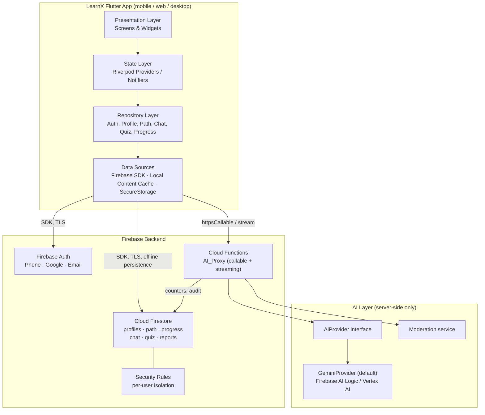
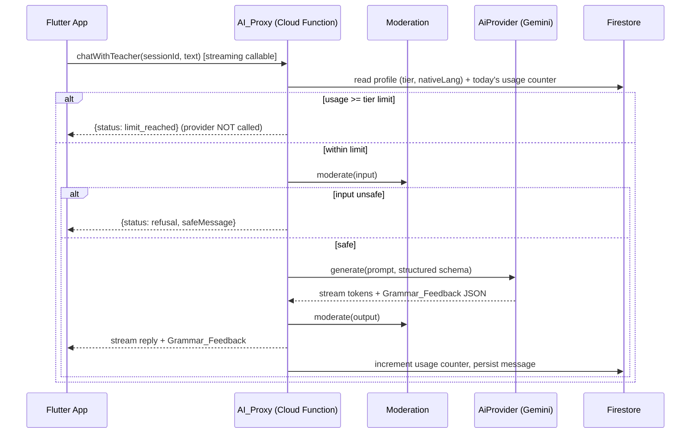

# Design Document

## Overview

LearnX is a cross-platform English-learning app built on a single Flutter codebase (mobile, web, desktop) with a Firebase backend. This design translates the 12 MVP requirements into an architecture that is provider-swappable, offline-tolerant on mobile, and privacy-compliant, while keeping every AI generation call behind a server-side proxy.

The guiding principles:

- **Server-mediated AI.** No client ever talks to an AI provider directly. All generation, moderation, and usage-limit enforcement happen inside Cloud Functions (the `AI_Proxy`). Provider credentials never leave the server. (Req 10.2, 11.1)
- **Provider abstraction.** The `AI_Proxy` depends on an `AiProvider` interface. The default implementation is Google Gemini via Firebase AI Logic / Vertex AI; swapping providers is a server-side change with no client impact. (Req 11.2)
- **Offline-first for authored content.** Pre-authored lesson content is cached locally on mobile for read/practice offline. Chat and quizzes require network. Firestore offline persistence carries progress data across reconnects. (Req 8)
- **Feature-first Flutter layering.** Presentation → State (Riverpod) → Repository → Data Source, so features stay isolated and testable and deferred phases (voice, jobs, billing) slot in without churn.
- **Deferred-phase safety.** Data models and interfaces reserve room for premium billing, voice, job modules, and additional native languages without reshaping the MVP.

This document specifies HOW the MVP is built. It does not introduce scope beyond the requirements.

## Architecture

### High-Level Architecture



### Request Flow: AI Teacher Chat (representative path)



The same gate order — **usage check → input moderation → provider call → output moderation → persist** — applies to every metered AI function (chat, lesson personalization, placement generation). Only the prompt shape and response schema differ.

## Flutter App Structure

### State Management Decision: Riverpod

**Recommendation: Riverpod (v2, code-generated).** Justification against Bloc:

- **Less boilerplate per feature.** Providers/Notifiers express async state (`AsyncValue`) directly; we avoid the event/state class pairs Bloc requires for every interaction. With five feature areas under time pressure, this materially reduces surface area.
- **Compile-safe dependency graph.** Repositories, the Firebase clients, and derived state are wired as providers with compile-time references — no `BuildContext` lookups, which matters for a codebase spanning mobile/web/desktop where context availability differs.
- **First-class async + caching.** `AsyncNotifier` and `FutureProvider` model the load/data/error triad the UI needs for network-dependent screens (chat, quiz) and cache-backed screens (learning path), and `ref.watch` gives automatic recomputation.
- **Testability.** `ProviderContainer` with overridden repository providers makes unit and widget tests straightforward without a running app.

Bloc's explicit event log is valuable for complex, auditable state machines, but the MVP's flows are predominantly request/response and cache-backed reads, where Riverpod's ergonomics win. The placement-test and quiz-session state machines are localized enough to model as `Notifier`s.

### Feature-First Folder Structure

```
lib/
  main.dart
  app/
    app.dart                 # MaterialApp, router, theme
    router.dart              # go_router config + auth/onboarding guards
    theme.dart
  core/
    result.dart              # Result<T> / failure types
    errors/                  # AppException hierarchy
    network/
      connectivity.dart      # online/offline stream
    ai/
      ai_function_client.dart  # httpsCallable + streaming wrappers
    firebase/
      firebase_providers.dart  # FirebaseAuth, Firestore instances as providers
    storage/
      secure_storage.dart
    config/
      remote_config.dart       # tier limits, feature flags
  features/
    auth/
      presentation/          # sign-in screens, widgets
      application/           # AuthController (Riverpod Notifier)
      data/                  # AuthRepository + AuthDataSource
      domain/                # AuthSession, AuthMethod
    onboarding/
      presentation/          # level, goal, language, placement screens
      application/           # OnboardingController, PlacementController
      data/                  # OnboardingRepository
      domain/                # Profile draft, PlacementEngine, CefrLevel
    learning_path/
      presentation/          # path screen, step circles, step detail
      application/           # PathController
      data/                  # PathRepository, ContentCacheDataSource
      domain/                # Section, Week, Step, StepState, StepProgress
    chat/
      presentation/          # chat screen, message bubbles, feedback card
      application/           # ChatController (streaming)
      data/                  # ChatRepository
      domain/                # ChatMessage, GrammarFeedback, Report
    quiz/
      presentation/          # quiz screen, question widgets, results
      application/           # QuizController
      data/                  # QuizRepository, ReviewQueueDataSource
      domain/                # Question, Answer, ReviewItem, SpacedRepetition
    progress/
      presentation/          # streak, goal tracker, badges, weekly summary
      application/           # ProgressController
      data/                  # ProgressRepository
      domain/                # Streak, Badge, WeeklySummary
    account/
      presentation/          # account screen, consent, data-delete, premium placeholder
      application/
      data/
    shell/
      presentation/          # bottom nav scaffold (Home / AI / Account)
  shared/
    widgets/                 # reusable UI (buttons, empty states, error views)
    models/                  # cross-feature value objects
```

Each feature owns its four layers. The `shell` feature hosts the bottom navigation scaffold (Req 12). Cross-feature value objects live in `shared/models`. This layout keeps deferred features additive: a `voice/`, `jobs/`, or `billing/` folder drops in beside the others.

### Layer Responsibilities

- **Presentation.** Stateless/consumer widgets that watch controllers and render. No business logic, no direct SDK calls.
- **Application (state).** Riverpod `Notifier`/`AsyncNotifier` controllers. Orchestrate use-cases, hold view state, translate exceptions into UI-facing states.
- **Data (repository).** Repositories expose domain-typed methods and hide data sources. They decide cache-vs-network, map DTOs to domain models, and normalize errors into `Result<T>`.
- **Data source.** Thin wrappers over `FirebaseAuth`, `Firestore`, the callable-function client, the local content cache, and secure storage.

## Components and Interfaces

This section catalogs the major components and the interfaces (contracts) between them. Detailed schemas and function bodies appear in the sections that follow.

### Client Components (Flutter)

| Component | Responsibility | Key interface / dependencies |
| --- | --- | --- |
| `AuthRepository` / `AuthController` | Sign-in via phone, Google, email; expose session state | `FirebaseAuth`; emits `AuthSession` to UI |
| `OnboardingRepository` / `PlacementController` | Capture level, goal, native language; drive adaptive placement | `generatePlacementQuestion` callable; writes `profile/main` |
| `PathRepository` / `PathController` | Load learning path, resolve step state, request personalization | `content/**` (cached) + `personalizeLesson` callable |
| `ChatRepository` / `ChatController` | Stream teacher chat, render `GrammarFeedback`, file reports | `chatWithTeacher` streaming callable; writes `reports` |
| `QuizRepository` / `QuizController` | Run quiz sessions, score answers, schedule spaced repetition | `quizItems` bank + `reviewQueue` |
| `ProgressRepository` / `ProgressController` | Streaks, daily goal, badges, weekly summary | transactional writes to `progress/main` |
| `AiFunctionClient` | Uniform `httpsCallable` + streaming wrapper for all AI calls | Firebase Functions SDK |
| `ConnectivityService` | Online/offline stream used to fail network-required features fast | platform connectivity |

Every repository exposes domain-typed methods returning `Result<T>` and hides its data sources from the presentation and application layers (see Layer Responsibilities above).

### Server Components (Cloud Functions)

| Component | Responsibility | Interface |
| --- | --- | --- |
| `AI_Proxy` callables | `chatWithTeacher`, `personalizeLesson`, `generatePlacementQuestion` | Firebase callable/streaming; verified `uid` |
| `meteredAi` middleware | Enforce gate order: usage → input moderation → provider → output moderation → persist | shared pipeline (see Cloud Functions Design) |
| `AiProvider` | Provider abstraction returning a normalized `AiResult` | `generate` / `generateStream` (see interface below) |
| `GeminiProvider` | Default `AiProvider` implementation | Firebase AI Logic / Vertex AI |
| `Moderation` service | Classify learner input and AI output; withhold unsafe content | swappable `moderate(content) -> { safe }` |
| `deleteMyData` callable | Erase `users/{uid}/**` and revoke auth (DPDP erasure) | Firebase callable |
| Weekly-summary scheduled function | Aggregate `dailyActivity/*` into `weeklySummaries/{isoWeek}` | Cloud Scheduler trigger |

### Key Interfaces

The primary server-side contract is the `AiProvider` interface plus the normalized `AiRequest`/`AiResult` types, specified in full under [Provider Abstraction Interface](#provider-abstraction-interface). The primary client-facing data contract is the `Grammar_Feedback` response schema, specified under [Grammar_Feedback Response Schema](#grammar_feedback-response-schema). Together these are the substitutability and rendering contracts the rest of the system depends on.

## Data Models

### Firestore Collections

Collections are keyed for per-user isolation and single-document reads on hot paths. Timestamps are server timestamps; all writes that participate in sync carry `updatedAt` for last-write-wins resolution.

```
users/{uid}
  createdAt, lastActiveAt
  accountTier: "free" | "premium"        # premium reserved; MVP defaults free
  consent: { dpdpAccepted: bool, acceptedAt, policyVersion }
  authMethods: ["phone" | "google" | "email"]

users/{uid}/profile/main
  englishLevel: "A1".."C1"                # self-selected then refined by placement
  goal: "speaking" | "job" | "both"
  nativeLanguage: "hi" | "ta" | "te" | "bn" | "mr"
  placementLevel: "A1".."C1"
  onboarded: bool
  updatedAt

# --- Authored skeleton: global, read-only to clients, cacheable ---
content/paths/{pathId}
  title, order
content/paths/{pathId}/sections/{sectionId}
  title, order
content/paths/{pathId}/sections/{sectionId}/weeks/{weekId}
  title, order
.../weeks/{weekId}/steps/{stepId}
  title, order, type
  skeleton: { objectives, examples[], practice[] }   # authored fallback content
  contentVersion                                       # for cache invalidation

# --- Per-user progress over the path ---
users/{uid}/pathProgress/{stepId}
  state: "locked" | "available" | "completed"
  completedAt, updatedAt

# --- Chat ---
users/{uid}/chatSessions/{sessionId}
  createdAt, lastMessageAt, title
users/{uid}/chatSessions/{sessionId}/messages/{messageId}
  role: "user" | "assistant"
  text
  grammarFeedback: GrammarFeedback | null    # see schema below
  createdAt

# --- Wrong-correction reports (moderation review queue) ---
users/{uid}/reports/{reportId}
  sessionId, messageId
  originalText, grammarFeedback              # full context snapshot
  reason, status: "open" | "reviewed"
  createdAt

# --- Quiz + spaced-repetition review queue ---
quizItems/{itemId}                            # authored/global question bank
  type: "fill_blank" | "choose_word"
  prompt, options[], answer, tags[]
users/{uid}/reviewQueue/{itemId}
  itemId
  intervalIndex: int                          # index into interval ladder
  dueDate: timestamp
  lastResult: "correct" | "wrong"
  updatedAt
users/{uid}/quizSessions/{sessionId}
  startedAt, completedAt
  correctCount, wrongCount

# --- Progress / rewards ---
users/{uid}/progress/main
  currentStreak, longestStreak
  lastActivityDate: "YYYY-MM-DD"
  dailyGoal: { day: int, targetPerDay: int }
  badges: [{ tier: "bronze"|"silver"|"gold", awardedAt, milestone }]
users/{uid}/progress/main/dailyActivity/{yyyy-mm-dd}
  activities: int, timeSpentSec, wordsLearned, mistakesFixed
users/{uid}/weeklySummaries/{isoWeek}
  timeSpentSec, wordsLearned, mistakesFixed, generatedAt

# --- Server-side usage metering (written only by functions) ---
users/{uid}/usage/{yyyy-mm-dd}
  chatMessages: int
  lessonPersonalizations: int
  placementGenerations: int
```

### Security Rules Approach

- **Default deny.** No collection is readable/writable unless a rule allows it.
- **Per-user isolation.** Everything under `users/{uid}/**` requires `request.auth.uid == uid` for read and write, except:
  - `usage/**` and `reports/**` write access is **denied to clients** — only Cloud Functions (Admin SDK, which bypasses rules) write these. Clients may read their own `usage` (to show remaining quota) but never mutate it. This makes usage limits and audit records tamper-proof from the client. (Req 11.3, 11.4)
  - `accountTier` and `consent.policyVersion` are read-only to clients; tier changes come from the server (reserved for billing phase).
- **Authored content read-only.** `content/**` and `quizItems/**` are world-readable to authenticated users, writable only by server/admin.
- **Field validation in rules.** `nativeLanguage`, `goal`, `englishLevel`, `placementLevel`, and `badge.tier` are validated against their allowed enums at write time so malformed profiles cannot be stored. (Req 2.3, 2.5)
- **Consent gate.** Writes to feature data can require `consent.dpdpAccepted == true` on the parent user doc, backing the DPDP consent requirement. (Req 10.3)

## Cloud Functions Design (AI_Proxy)

All AI functions are HTTPS callable functions (with a streaming variant for chat) so the client authenticates via the Firebase SDK and Cloud Functions receives a verified `uid`. No API gateway keys are shipped to clients. (Req 11.1)

### Provider Abstraction Interface

```
// Server-side (TypeScript in functions/)
interface AiRequest {
  kind: "chat" | "lessonPersonalization" | "placementQuestion";
  uid: string;
  nativeLanguage: NativeLanguage;
  cefrLevel: CefrLevel;
  payload: object;            // kind-specific
  responseSchema: JsonSchema; // structured-output contract
}

interface AiResult {
  text?: string;              // free-form reply (chat)
  structured?: object;        // schema-conformant JSON (feedback, questions)
  stream?: AsyncIterable<string>;
}

interface AiProvider {
  readonly id: string;                       // e.g. "gemini-1.5"
  generate(req: AiRequest): Promise<AiResult>;
  generateStream(req: AiRequest): AsyncIterable<AiResult>;
}

// Default implementation
class GeminiProvider implements AiProvider { /* Firebase AI Logic / Vertex AI */ }

// Selection is config-driven; swapping providers is a server-only change.
function resolveProvider(): AiProvider {
  return providerRegistry[config.aiProviderId] ?? new GeminiProvider();
}
```

Every provider returns a **normalized `AiResult`** so downstream code (moderation, persistence, client contract) is provider-agnostic. This is the substitutability guarantee the proxy relies on. (Req 11.2)

### Callable Functions

1. **`chatWithTeacher` (streaming).** Input: `{ sessionId, text }`. Runs the gate order (usage → input moderation → provider → output moderation → persist). Returns a streamed reply plus a `Grammar_Feedback` object. Emits first tokens as soon as the provider streams, to meet the <2s time-to-first-token target. (Req 4.1–4.4, 5.1–5.2)
2. **`personalizeLesson`.** Input: `{ stepId }`. Returns AI-personalized examples/practice for a step, tagged by the learner's CEFR level and goal. On any failure or moderation refusal, returns an empty/`null` personalization so the client falls back to authored skeleton content. (Req 3.5, 3.6)
3. **`generatePlacementQuestion`.** Input: `{ sessionState }` (current difficulty band, prior answers). Returns the next adaptive question at the requested difficulty. Server-generated so the difficulty ladder and answer keys stay off the client. (Req 2.4)

Each metered function shares a middleware pipeline:

```
async function meteredAi(context, kind, handler) {
  const uid = requireAuth(context);
  const { tier } = await getUserTier(uid);
  const limit = limitsFor(tier)[kind];              // from Remote Config
  const used  = await getTodayUsage(uid, kind);
  if (used >= limit) return { status: "limit_reached", limit };   // provider NOT called

  const inputCheck = await moderate(context.input);
  if (!inputCheck.safe) return { status: "refusal", safeMessage };

  const result = await handler(resolveProvider());  // provider call

  const outputCheck = await moderate(result);
  if (!outputCheck.safe) return { status: "refusal", safeMessage };

  await incrementUsage(uid, kind);                  // only after success
  return { status: "ok", result };
}
```

### Grammar_Feedback Response Schema

The provider is prompted with a structured-output schema; the function validates the response against it before returning:

```json
{
  "type": "object",
  "properties": {
    "hasMistake":        { "type": "boolean" },
    "mistakeSpan":       {
      "type": "object",
      "properties": {
        "start": { "type": "integer" },
        "end":   { "type": "integer" },
        "text":  { "type": "string" }
      },
      "required": ["start", "end", "text"]
    },
    "correctedSentence": { "type": "string" },
    "tip":               { "type": "string" },
    "translation": {
      "type": "object",
      "properties": {
        "language": { "type": "string", "enum": ["hi","ta","te","bn","mr"] },
        "text":     { "type": "string" }
      },
      "required": ["language", "text"]
    }
  },
  "required": ["hasMistake", "correctedSentence", "tip", "translation"]
}
```

The client renders `mistakeSpan.text` in red and `correctedSentence` in green, shows `tip`, and shows `translation.text` in the learner's `nativeLanguage`. When `hasMistake` is false, `mistakeSpan` is omitted and no red styling is applied. (Req 4.2, 4.3)

### Moderation Step

Moderation runs as a distinct step on **both** the learner input and the AI output for every chat and personalization call. It is a swappable service (provider safety API or a dedicated classifier). On an unsafe verdict the unsafe content is withheld and a safe substitute/refusal is returned — the flagged content never reaches the client or persistence. (Req 5.1, 5.2, 10.4)

### Usage-Limit Enforcement

Per-tier daily counters live at `users/{uid}/usage/{yyyy-mm-dd}` and are written **only** by functions via the Admin SDK. The limit check happens before any provider call; exceeding it returns `limit_reached` and the provider is never invoked, so no cost is incurred and the counter is not incremented. Limits are read from Remote Config so they can be tuned without redeploying. (Req 4.6, 11.3, 11.4)

## Adaptive Placement Algorithm

A simple difficulty-band ladder mapped to CEFR. Questions are drawn/generated per band; the band steps up on a correct answer and down on a wrong one, within bounds.

```
bands = [A1, A2, B1, B2, C1]   # indices 0..4
state = { bandIndex: 1 (A2 start), asked: 0, correctByBand: {} }

nextQuestion():
  return generatePlacementQuestion(band = bands[state.bandIndex])

onAnswer(correct):
  record correctByBand[state.bandIndex]
  if correct: state.bandIndex = min(state.bandIndex + 1, 4)   # step up
  else:       state.bandIndex = max(state.bandIndex - 1, 0)   # step down
  state.asked += 1

finish():                      # after fixed N questions (e.g. 8)
  # settle at the highest band the learner answered correctly a majority of the time,
  # clamped by where they stabilized
  assignedLevel = bands[settleIndex(correctByBand, finalBandIndex = state.bandIndex)]
  store profile.placementLevel = assignedLevel
```

`settleIndex` biases toward the band where performance stabilized rather than the last swing, avoiding a single lucky/unlucky answer determining the level. The result is always one of the five CEFR levels. (Req 2.4, 2.5)

## Spaced-Repetition Scheduling

A fixed interval ladder (Leitner-style), simple and deterministic — no external SM-2 complexity for the MVP.

```
INTERVALS_DAYS = [1, 3, 7, 16, 35]   # intervalIndex -> days until next due

onWrongAnswer(itemId):               # from any quiz
  upsert reviewQueue[itemId]:
    intervalIndex = 0
    dueDate = today + INTERVALS_DAYS[0]
    lastResult = "wrong"

dueItems(now):                       # at quiz start
  return reviewQueue where dueDate <= now, ordered by dueDate

onReviewAnswer(itemId, correct):
  if correct:
    intervalIndex = min(intervalIndex + 1, len(INTERVALS_DAYS) - 1)  # longer interval
    dueDate = today + INTERVALS_DAYS[intervalIndex]
    if intervalIndex == last: optionally graduate (remove) after final success
  else:
    intervalIndex = 0                # reset to shortest
    dueDate = today + INTERVALS_DAYS[0]
```

A correct review answer always advances to a strictly longer interval (monotonic within the ladder), and only due items surface in a session. (Req 6.3, 6.4, 6.5)

## Streaks, Badges, and Weekly Summary

### Where computation runs

- **Streaks and daily goal: client-computed, server-persisted.** These update the instant a learner completes an activity, so the client updates `progress/main` transactionally (increment or reset based on `lastActivityDate` vs today) for immediate UI feedback, and the write syncs to Firestore. This keeps the streak flame responsive and works during brief offline gaps. (Req 3.7, 7.1, 7.5)
- **Badges: client-evaluated against server-defined thresholds.** When progress crosses a milestone, the client awards the matching badge and records it; thresholds come from config so the rules are centralized. (Req 7.3)
- **Weekly summary: scheduled Cloud Function.** A weekly scheduled function aggregates `dailyActivity/*` into `weeklySummaries/{isoWeek}` (time spent, words learned, mistakes fixed), so the summary is consistent and not dependent on a client being online at week boundary. The client can also compute a live current-week view from `dailyActivity`. (Req 7.4)

### Streak rule

```
onQualifyingActivity(date):
  if lastActivityDate == date:          no-op (already counted today)
  elif lastActivityDate == date - 1:    currentStreak += 1
  else:                                 currentStreak = 1     # gap resets
  longestStreak = max(longestStreak, currentStreak)
  lastActivityDate = date
```

The current streak always equals the length of the current consecutive-day run; longest streak is monotonic and never below current. (Req 7.1, 7.5)

## Offline Caching and Sync Strategy

- **Authored content cache.** On mobile, authored step skeletons (`content/**`) are cached in a local store (Firestore offline persistence for the documents plus a lightweight local content cache keyed by `contentVersion` for larger blobs). Cached steps are fully readable and practiceable offline. (Req 8.1)
- **Firestore offline persistence.** Enabled on mobile so per-user progress writes (`pathProgress`, `progress/main`, `quizSessions` results already earned) queue locally and replay on reconnect. (Req 8.2)
- **Sync resolution.** Documents carry `updatedAt`; conflicts resolve last-write-wins by timestamp. Progress increments (streak, counts) are written as transactional reads-modify-writes so replayed local writes reconcile against server state rather than blindly overwriting. (Req 8.2)
- **Cross-device restore.** On sign-in, the client reads `users/{uid}/**`, rehydrating profile and progress on the new device. (Req 8.3)
- **Network-required features.** Chat and quizzes check connectivity first and, when offline, show a clear network-required message rather than queuing silently. (Req 4.5, 6.6, 8.4)
- **Web/desktop.** The offline content cache is a mobile guarantee; web/desktop rely on Firestore persistence where the platform supports it and otherwise operate online.

## Security, Privacy, and DPDP Compliance

- **Encryption.** All transport uses TLS via the Firebase SDKs; Firestore and Cloud Functions provide managed encryption at rest. Sensitive local values (tokens) use platform secure storage. (Req 10.1)
- **Server-side credentials.** AI provider keys exist only in the Functions runtime configuration, never in client code or config. All AI traffic is proxied. (Req 10.2, 11.1)
- **DPDP consent capture.** On first run after auth, the client presents a consent screen and records `consent.dpdpAccepted`, `acceptedAt`, and `policyVersion` on the user document. Personal-data processing (including AI calls) is gated on recorded consent via security rules and function checks. (Req 10.3)
- **Data-delete path.** An account action triggers a `deleteMyData` callable function that removes `users/{uid}/**` subtree, associated `reports`, and revokes the auth user — supporting the DPDP right to erasure. (Req 10.3)
- **All-ages moderation.** Both input and output are moderated on every AI call; unsafe content is withheld. (Req 5.1, 5.2, 10.4)
- **Report-a-wrong-correction storage.** Each `Grammar_Feedback` item exposes a report control; reports persist to `users/{uid}/reports/{reportId}` with the full context snapshot and a confirmation is shown. (Req 5.3, 5.4)

## Error Handling

- Repositories return a `Result<T>` (success or typed `AppException`): `NetworkException`, `AuthException`, `UsageLimitException`, `ModerationRefusalException`, `NotFoundException`.
- Controllers map exceptions to `AsyncValue.error` states; the UI renders consistent error/empty views with retry where safe.
- AI function responses use an explicit `status` (`ok` | `limit_reached` | `refusal` | `error`) so the client branches without inspecting free-form text.
- Offline is detected proactively via a connectivity stream, so network-required features fail fast with a clear message instead of hanging. (Req 4.5, 6.6)

## Performance

- **App open < 3s (Req 9.1):** deferred/lazy provider initialization, a lightweight first interactive screen, cached auth session for instant routing, and cached authored content so the learning path renders without a network round-trip.
- **AI reply starts < 2s (Req 9.2):** streaming callable for chat renders tokens as they arrive; the usage/moderation gate on input is a single fast Firestore read plus a lightweight classifier before streaming begins.
- **Low-end/slow network (Req 9.3):** minimize main-thread work, paginate chat history, keep authored content local, and avoid large synchronous reads on startup.

## Testing Strategy

- **Unit tests (repositories, domain logic, functions).** Placement ladder, spaced-repetition scheduling, streak computation, badge thresholds, quiz scoring, and the Grammar_Feedback schema mapping are pure logic tested directly. Function middleware (usage gate order, moderation gating) tested with mocked provider and Firestore.
- **Property-based tests.** Cover the universal properties in the next section (100+ iterations each): placement bounds/level assignment, unlock invariant, spaced-repetition monotonicity, streak run-length, usage-limit gate, feedback rendering completeness, and provider substitutability.
- **Widget tests.** Sign-in error handling, onboarding steps, bottom navigation and premium placeholder, quiz question rendering, feedback card styling (red mistake / green correction), offline network-required messages.
- **Cloud Functions emulator tests.** Auth flows, callable AI functions with a mock `AiProvider`, moderation refusal path, usage-counter increments, security-rules tests (per-user isolation, client cannot write `usage`/`reports`, consent gate).
- **Integration/benchmark.** App-open and time-to-first-token benchmarks; cross-device restore; offline read of cached content.
- **Provider swap test.** A fake `AiProvider` substituted for `GeminiProvider` confirms the proxy contract holds without client changes.

## Correctness Properties

*A property is a characteristic or behavior that should hold true across all valid executions of a system — essentially, a formal statement about what the system should do. Properties serve as the bridge between human-readable specifications and machine-verifiable correctness guarantees.*

### Property 1: Successful authentication yields a signed-in session with a profile

*For any* successful authentication result, the resulting session state is signed-in and a learner profile exists, whether newly created or restored.

**Validates: Requirements 1.4**

### Property 2: Native language is accepted only from the allowed set

*For any* submitted native-language value, it is accepted and stored if and only if it is one of {Hindi, Tamil, Telugu, Bengali, Marathi}.

**Validates: Requirements 2.3**

### Property 3: Placement difficulty steps within bounds

*For any* sequence of placement answers, the difficulty band increases after a correct answer and decreases after a wrong answer, and never leaves the range A1–C1.

**Validates: Requirements 2.4**

### Property 4: Placement always assigns a valid CEFR level

*For any* completed placement session, the assigned level is exactly one of {A1, A2, B1, B2, C1} and is stored on the profile.

**Validates: Requirements 2.5**

### Property 5: Onboarding completion transition

*For any* profile that has a selected level, goal, native language, and a placement result, the profile is marked onboarded.

**Validates: Requirements 2.6**

### Property 6: Path unlock invariant

*For any* learning path and progress state, a step is startable if and only if it is the first step or its immediately preceding step is completed, and completing a step makes the immediately next step available.

**Validates: Requirements 3.2, 3.3, 3.4**

### Property 7: Skeleton content is always present regardless of AI personalization

*For any* step, the rendered step content always contains the authored skeleton content; AI-personalized content is strictly additive and its absence never removes the skeleton.

**Validates: Requirements 3.5, 3.6**

### Property 8: Grammar feedback rendering completeness

*For any* Grammar_Feedback item, the rendered output styles the mistake span in red and the corrected sentence in green (or omits the mistake span when there is no mistake) and always includes the tip and a translation in the learner's native language.

**Validates: Requirements 4.2, 4.3**

### Property 9: Unsafe content is never passed through

*For any* message or reply flagged unsafe by moderation, the returned response never contains the flagged content and is a safe substitute or refusal.

**Validates: Requirements 5.2, 10.4**

### Property 10: Every feedback item exposes a report control

*For any* list of rendered Grammar_Feedback items, each item exposes a report-a-wrong-correction control.

**Validates: Requirements 5.3**

### Property 11: Reports preserve context (round-trip)

*For any* reported wrong correction, the stored report record reproduces the original message and the associated feedback context, and a receipt is confirmed to the learner.

**Validates: Requirements 5.4**

### Property 12: Quiz answer counts are consistent

*For any* completed quiz, the reported correct count plus wrong count equals the number of questions answered.

**Validates: Requirements 6.2**

### Property 13: Every wrong answer enters the review queue

*For any* quiz result, every incorrectly answered question is present in the review queue.

**Validates: Requirements 6.3**

### Property 14: Only due review items are presented

*For any* review queue and any current time, the items reintroduced in a quiz session are exactly those whose due date is on or before that time.

**Validates: Requirements 6.4**

### Property 15: Correct review answers lengthen the interval

*For any* review item answered correctly, its new review interval is strictly longer than its previous interval (up to the maximum) and its next due date is later.

**Validates: Requirements 6.5**

### Property 16: Longest streak dominates current streak

*For any* streak history, the longest streak is greater than or equal to the current streak, and both are non-negative.

**Validates: Requirements 7.1**

### Property 17: Badge award matches milestone thresholds

*For any* progress value, the highest badge awarded corresponds monotonically to the configured milestone thresholds it has crossed.

**Validates: Requirements 7.3**

### Property 18: Weekly summary aggregates match underlying events

*For any* week of recorded daily activity, the weekly summary's time spent, words learned, and mistakes fixed equal the sums of the corresponding daily activity values.

**Validates: Requirements 7.4**

### Property 19: Current streak equals the current consecutive-day run

*For any* sequence of qualifying-activity dates, the current streak equals the length of the most recent run of consecutive calendar days, resetting after any gap.

**Validates: Requirements 3.7, 7.5**

### Property 20: Offline progress writes survive sync

*For any* set of progress writes made while offline, after connectivity is restored the backend state reflects all of those writes under last-write-wins-by-timestamp resolution.

**Validates: Requirements 8.2**

### Property 21: Processing is gated on recorded consent

*For any* learner without recorded DPDP consent, personal-data processing requests (including AI calls) are blocked until consent is stored.

**Validates: Requirements 10.3**

### Property 22: Provider substitutability

*For any* provider implementing the AiProvider interface, the AI_Proxy returns a normalized response conforming to the expected schema without requiring client changes.

**Validates: Requirements 11.2**

### Property 23: Usage-limit gate

*For any* account tier with daily limit L and used count u for a metered action, the request is allowed if and only if u is less than L; when a request is rejected as limit-reached, the AI provider is not invoked and the usage counter is unchanged.

**Validates: Requirements 4.6, 11.3, 11.4**

### Property 24: Navigation maps destinations to screens

*For any* selected bottom-navigation destination, the displayed screen equals the screen mapped to that destination.

**Validates: Requirements 12.2**
